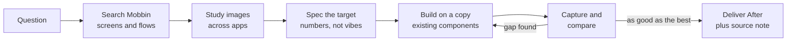

# mobbin-design-research

Turn Mobbin research into better screens: a skill for any AI agent (Claude Code, Codex, Cursor, Gemini CLI, Copilot, chat apps) that studies how real apps solve a problem, then rebuilds your design against that evidence.

[](LICENSE)


English | [Português (Brasil)](README.pt-BR.md)

## What it does

Most reference hunting ends as a moodboard nobody uses. This skill makes research accountable:

- Every search answers a named question, and every screen cited carries its durable `mobbin_url`.
- It reads your project rules first. Research informs the design; it never overrides your design system.
- It ships two playbooks: **design a flow from scratch** and **improve an existing screen** (always on a copy, with one "After" version and a note that lists the source of every change).
- Both playbooks end in a **capture-and-compare loop** in your design tool, repeated until your screen is at least as good as the best reference.
- It saves what it learned (downloaded images, `REFERENCES.md`, `PATTERNS.md`) so the research outlives the chat.

## Requirements

- An AI agent that supports [Agent Skills](https://agentskills.io) (Claude Code, Codex, Cursor, Gemini CLI, GitHub Copilot...) or any chat app (ChatGPT, Gemini, Claude.ai Projects) via the pasteable prompt.
- Recommended: the official Mobbin MCP server and a paid Mobbin plan (Pro, Team or Enterprise). It is hosted at `https://api.mobbin.com/mcp` and exposes three read-only tools: `search_screens`, `search_flows` and `search_sections`. No Mobbin Pro? See [manual mode](#no-mobbin-pro-use-manual-mode).
- A design tool the agent can capture screens from. Figma is the default; the loop works with any tool that supports "capture and compare".

## Install

### a) Quick (any agent)

```bash
npx skills add joaoezau/mobbin-design-research
```

The [`skills`](https://github.com/vercel-labs/skills) CLI detects the agents you have installed. Target specific ones with `-a`, for example `-a claude-code -a codex -a cursor`.

### b) Manual

The skill is a folder with `SKILL.md` at its root (`skills/mobbin-design-research/`). Copy it into your agent's skills folder:

| Agent | Project path | User path |
|---|---|---|
| Neutral (read by several agents) | `.agents/skills/` | |
| Claude Code | `.claude/skills/` | `~/.claude/skills/` |
| Codex | `.agents/skills/` (some versions: `.codex/skills/`) | `~/.codex/skills/` (check your Codex version's docs) |
| Cursor | `.cursor/skills/` (also reads `.agents/skills/`) | |
| Gemini CLI | `.gemini/skills/` (also `.agents/skills/`) | `~/.gemini/skills/` |
| GitHub Copilot | `.github/skills/` | `~/.copilot/skills/` |

```bash
git clone https://github.com/joaoezau/mobbin-design-research.git
mkdir -p .claude/skills            # pick the folder from the table
cp -r mobbin-design-research/skills/mobbin-design-research .claude/skills/
```

Restart the agent (or open a new session) so it picks up the skill.

### c) Chat apps (ChatGPT, Gemini, Claude.ai Projects)

Paste [`adapters/mobbin-design-research.prompt.md`](adapters/mobbin-design-research.prompt.md) into a Custom GPT or ChatGPT Project's instructions, a Gemini Gem, a Claude Project, or any system prompt. It is the whole skill in one file. Chat apps without MCP use the manual mode below; if your ChatGPT plan supports MCP connectors, you can connect Mobbin there.

### d) Cursor rule (older Cursor versions without skills)

Copy [`adapters/cursor/mobbin-design-research.mdc`](adapters/cursor/mobbin-design-research.mdc) to `.cursor/rules/`. It carries the full skill content.

### e) AGENTS.md snippet

Paste [`adapters/AGENTS.snippet.md`](adapters/AGENTS.snippet.md) into your `AGENTS.md`, `GEMINI.md` or `.github/copilot-instructions.md` so the agent knows when to load the skill and where it lives.

## Connect the Mobbin MCP

Each tool has its own MCP config; follow its docs and Mobbin's ([mobbin.com/mcp](https://mobbin.com/mcp), [mobbin/mobbin-mcp-server](https://github.com/mobbin/mobbin-mcp-server)). The server is hosted (Streamable HTTP) and uses OAuth: a browser sign-in on first use, no API key. A generic config:

```json
{ "mcpServers": { "mobbin": { "url": "https://api.mobbin.com/mcp" } } }
```

Some clients (for example Cline) need `"type": "streamableHttp"` too. In Claude Code, for instance, check with `/mcp` that the Mobbin tools are listed; other tools have their own way to list connected servers. Rate limit: 60 requests per 60 seconds per user (HTTP 429 with `Retry-After`).

## Saving Mobbin AI credits

Mobbin charges AI credits only for Deep Search (`search_screens` with `mode="deep"`): 5 per search that returns results; Pro includes 300 a month ([docs](https://docs.mobbin.com/ai-credits)). Standard search, flows, sections and collections are free. The skill starts with free searches, uses Deep Search only when they fall short (default budget: 1 per screen, 3 per task, then it asks you), never repeats a search, and reports how many it used. Set `deep_search_allowed: false` in `project-config.md` to spend zero credits.

## No Mobbin Pro? Use manual mode

MCP access needs a paid plan (Pro, Team or Enterprise). Without it, the skill's "Without the Mobbin MCP" fallback applies: browse mobbin.com yourself and give the agent links, screenshots or your exported collection. It runs the same method on those and never pretends to have searched.

## Configure

Copy the template into your project and fill it in:

```bash
cp skills/mobbin-design-research/references/project-config.template.md ./project-config.md
```

It tells the skill where your rules file lives (for example `AGENTS.md` or `CLAUDE.md`), the target platform (`ios`, `android` or `web`), your design tool and design-system names, curated reference folders, priority apps, app-name quirks and your design tool's rate limits. If the file is missing, the skill offers to create it and falls back to sensible defaults.

## Usage

Example prompts:

- "Design the onboarding for my habit tracker. Search Mobbin first."
- "Improve this settings screen. Look at how the best apps handle grouped toggles."
- "How do other apps show a streak counter? Pull 5 references and extract the numbers."
- "Here is a screenshot I like; find where else this pattern is used and tell me if we should copy it."
- "Review the paywall flow against the best subscription flows on Mobbin."

## How it works



Decisions follow a fixed priority: your explicit decision, your rules file, your curation, Mobbin references, and only then agent judgment (which goes into the note as a suggestion, not into the design).

## Repo structure

```
mobbin-design-research/
  adapters/
    mobbin-design-research.prompt.md      # whole skill in one file, for chat apps
    cursor/mobbin-design-research.mdc     # Cursor rule
    AGENTS.snippet.md                     # paste into AGENTS.md / GEMINI.md
  scripts/build-prompt.sh                 # regenerates the adapters
  README.md
  README.pt-BR.md
  LICENSE
  skills/mobbin-design-research/
    SKILL.md                              # entry point and ground rules
    references/
      flow-from-scratch.md                # playbook: design a flow or area
      improve-a-screen.md                 # playbook: improve one screen, plus the loop
      methods.md                          # how to study flows and components
      project-config.template.md          # fill this in per project
    examples/
      REFERENCES.example.md               # sample references/mobbin/<area>/REFERENCES.md
      PATTERNS.example.md                 # sample cross-app PATTERNS.md
```

## Contributing

The prompt and the Cursor rule in `adapters/` are generated from the skill. After editing anything under `skills/`, run `bash scripts/build-prompt.sh` and commit the result.

## Credits

Adapted from the `appllama-usage` skill in [Appllama/appllama-skills](https://github.com/Appllama/appllama-skills) (MIT), by Antmind Ventures Private Limited ([appllama.io](https://appllama.io)). This version generalizes it, adds a project config and rewrites the playbooks around Mobbin.

## License

[MIT](LICENSE). Copyright (c) 2026 João Ezaú, and the original copyright of Antmind Ventures Private Limited.
