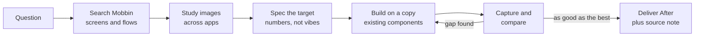

# mobbin-design-research

Turn Mobbin research into better screens: a Claude Code skill that studies how real apps solve a problem, then rebuilds your design against that evidence.

[](LICENSE)


English | [Português (Brasil)](README.pt-BR.md)

## What it does

Most reference hunting ends as a moodboard nobody uses. This skill makes research accountable:

- Every search answers a named question, and every screen cited carries its durable `mobbin_url`.
- It reads your project rules first. Research informs the design; it never overrides your design system.
- It ships two playbooks: **design a flow from scratch** and **improve an existing screen** (always on a copy, with one "After" version and a note that lists the source of every change).
- Both playbooks end in a **capture-and-compare loop** in your design tool, repeated until your screen is at least as good as the best reference.
- It saves what it learned (downloaded images, `REFERENCES.md`, `PATTERNS.md`) so the research outlives the chat.

## Requirements

- [Claude Code](https://claude.com/claude-code)
- A Mobbin account and the official Mobbin MCP server, which provides `search_screens`, `search_flows` and `search_sections` (and optionally `list_collections`, `get_collection_contents`, `save_content`).
- A design tool the agent can capture screens from. Figma is the default; the loop works with any tool that supports "capture and compare".

## Install

```bash
git clone https://github.com/joaoezau/mobbin-design-research.git
cd mobbin-design-research

# User-level (all projects)
mkdir -p ~/.claude/skills
cp -r skills/mobbin-design-research ~/.claude/skills/

# or project-level (this project only)
mkdir -p .claude/skills
cp -r skills/mobbin-design-research .claude/skills/
```

Restart Claude Code (or start a new session) so it picks up the skill.

### Connect the Mobbin MCP

Add the Mobbin MCP server to Claude Code following Mobbin's own documentation, then sign in with your Mobbin account. Check with `/mcp` that the Mobbin tools are listed.

## Configure

Copy the template into your project and fill it in:

```bash
cp skills/mobbin-design-research/references/project-config.template.md ./project-config.md
```

It tells the skill where your rules file lives (for example `AGENTS.md` or `CLAUDE.md`), the target platform (`ios`, `android` or `web`), your design tool and design-system names, curated reference folders, priority apps, app-name quirks and your design tool's rate limits. If the file is missing, the skill offers to create it and falls back to sensible defaults.

## Usage

Example prompts:

- "Design the onboarding for my habit tracker. Search Mobbin first."
- "Improve this settings screen. Look at how the best apps handle grouped toggles."
- "How do other apps show a streak counter? Pull 5 references and extract the numbers."
- "Here is a screenshot I like; find where else this pattern is used and tell me if we should copy it."
- "Review the paywall flow against the best subscription flows on Mobbin."

## How it works



Decisions follow a fixed priority: your explicit decision, your rules file, your curation, Mobbin references, and only then agent judgment (which goes into the note as a suggestion, not into the design).

## Repo structure

```
mobbin-design-research/
  README.md
  README.pt-BR.md
  LICENSE
  skills/mobbin-design-research/
    SKILL.md                              # entry point and ground rules
    references/
      flow-from-scratch.md                # playbook: design a flow or area
      improve-a-screen.md                 # playbook: improve one screen, plus the loop
      methods.md                          # how to study flows and components
      project-config.template.md          # fill this in per project
    examples/
      REFERENCES.example.md               # sample references/mobbin/<area>/REFERENCES.md
      PATTERNS.example.md                 # sample cross-app PATTERNS.md
```

## Credits

Adapted from the `appllama-usage` skill in [Appllama/appllama-skills](https://github.com/Appllama/appllama-skills) (MIT), by Antmind Ventures Private Limited ([appllama.io](https://appllama.io)). This version generalizes it, adds a project config and rewrites the playbooks around Mobbin.

## License

[MIT](LICENSE). Copyright (c) 2026 João Ezaú, and the original copyright of Antmind Ventures Private Limited.
