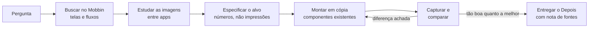

# mobbin-design-research

Transforme pesquisa no Mobbin em telas melhores: uma skill para qualquer agente de IA (Claude Code, Codex, Cursor, Gemini CLI, Copilot, apps de chat) que estuda como apps reais resolvem um problema e depois refaz o seu design com base nessa evidência.

[](LICENSE)


[English](README.md) | Português (Brasil)

## O que faz

A maioria das buscas por referência termina num moodboard que ninguém usa. Esta skill torna a pesquisa responsável:

- Cada busca responde a uma pergunta nomeada, e cada tela citada leva o `mobbin_url` durável.
- Ela lê as regras do seu projeto primeiro. A pesquisa informa o design; nunca passa por cima do seu design system.
- Traz dois roteiros: **desenhar um fluxo do zero** e **melhorar uma tela existente** (sempre em cópia, com uma única versão "Depois" e uma nota que lista a fonte de cada mudança).
- Os dois roteiros terminam num **loop de captura e comparação** na sua ferramenta de design, repetido até a sua tela ficar pelo menos tão boa quanto a melhor referência.
- Guarda o que aprendeu (imagens baixadas, `REFERENCES.md`, `PATTERNS.md`) para a pesquisa sobreviver ao chat.

## Requisitos

- Um agente de IA com suporte a [Agent Skills](https://agentskills.io) (Claude Code, Codex, Cursor, Gemini CLI, GitHub Copilot...) ou qualquer app de chat (ChatGPT, Gemini, Projetos do Claude.ai) pelo prompt para colar.
- Recomendado: o servidor MCP oficial do Mobbin e um plano pago do Mobbin (Pro, Team ou Enterprise). Ele é hospedado em `https://api.mobbin.com/mcp` e expõe três ferramentas somente leitura: `search_screens`, `search_flows` e `search_sections`. Sem o Mobbin Pro? Veja o [modo manual](#sem-mobbin-pro-use-o-modo-manual).
- Uma ferramenta de design da qual o agente consiga capturar telas. O Figma é o padrão; o loop funciona com qualquer ferramenta que permita "capturar e comparar".

## Instalação

### a) Rápida (qualquer agente)

```bash
npx skills add joaoezau/mobbin-design-research
```

A CLI [`skills`](https://github.com/vercel-labs/skills) detecta os agentes instalados. Escolha alguns com `-a`, por exemplo `-a claude-code -a codex -a cursor`.

### b) Manual

A skill é uma pasta com `SKILL.md` na raiz (`skills/mobbin-design-research/`). Copie-a para a pasta de skills do seu agente:

| Agente | Caminho do projeto | Caminho do usuário |
|---|---|---|
| Neutro (lido por vários agentes) | `.agents/skills/` | |
| Claude Code | `.claude/skills/` | `~/.claude/skills/` |
| Codex | `.agents/skills/` (algumas versões: `.codex/skills/`) | `~/.codex/skills/` (confira a documentação da sua versão do Codex) |
| Cursor | `.cursor/skills/` (também lê `.agents/skills/`) | |
| Gemini CLI | `.gemini/skills/` (também `.agents/skills/`) | `~/.gemini/skills/` |
| GitHub Copilot | `.github/skills/` | `~/.copilot/skills/` |

```bash
git clone https://github.com/joaoezau/mobbin-design-research.git
mkdir -p .claude/skills            # escolha a pasta da tabela
cp -r mobbin-design-research/skills/mobbin-design-research .claude/skills/
```

Reinicie o agente (ou abra uma nova sessão) para ele carregar a skill.

### c) Apps de chat (ChatGPT, Gemini, Projetos do Claude.ai)

Cole [`adapters/mobbin-design-research.prompt.md`](adapters/mobbin-design-research.prompt.md) nas instruções de um GPT personalizado ou Projeto do ChatGPT, num Gem do Gemini, num Projeto do Claude ou em qualquer prompt de sistema. É a skill inteira em um arquivo. Apps de chat sem MCP usam o modo manual abaixo; se o seu plano do ChatGPT aceitar conectores MCP, dá para conectar o Mobbin ali.

### d) Regra do Cursor (versões antigas, sem skills)

Copie [`adapters/cursor/mobbin-design-research.mdc`](adapters/cursor/mobbin-design-research.mdc) para `.cursor/rules/`. Ela traz o conteúdo completo da skill.

### e) Trecho para o AGENTS.md

Cole [`adapters/AGENTS.snippet.md`](adapters/AGENTS.snippet.md) no seu `AGENTS.md`, `GEMINI.md` ou `.github/copilot-instructions.md` para o agente saber quando carregar a skill e onde ela fica.

## Conectar o MCP do Mobbin

Cada ferramenta tem a sua própria configuração de MCP; siga a documentação dela e a do Mobbin ([mobbin.com/mcp](https://mobbin.com/mcp), [mobbin/mobbin-mcp-server](https://github.com/mobbin/mobbin-mcp-server)). O servidor é hospedado (Streamable HTTP) e usa OAuth: login pelo navegador no primeiro uso, sem chave de API. Uma configuração genérica:

```json
{ "mcpServers": { "mobbin": { "url": "https://api.mobbin.com/mcp" } } }
```

Alguns clientes (por exemplo o Cline) também precisam de `"type": "streamableHttp"`. No Claude Code, por exemplo, confira com `/mcp` se as ferramentas do Mobbin aparecem; outras ferramentas têm o seu próprio jeito de listar servidores conectados. Limite: 60 requisições por 60 segundos por usuário (HTTP 429 com `Retry-After`).

## Sem Mobbin Pro? Use o modo manual

O acesso por MCP exige plano pago (Pro, Team ou Enterprise). Sem ele vale o fallback "Without the Mobbin MCP" da skill: navegue no mobbin.com e entregue ao agente links, prints ou a sua coleção exportada. Ele aplica o mesmo método e nunca finge que pesquisou.

## Configuração

Copie o modelo para o seu projeto e preencha:

```bash
cp skills/mobbin-design-research/references/project-config.template.md ./project-config.md
```

Ele diz à skill onde fica o arquivo de regras (por exemplo `AGENTS.md` ou `CLAUDE.md`), a plataforma (`ios`, `android` ou `web`), a ferramenta de design e os nomes do design system, as pastas de referências curadas, os apps prioritários, as particularidades de nomes de apps e os limites de uso da sua ferramenta de design. Se o arquivo não existir, a skill se oferece para criá-lo e usa padrões razoáveis.

## Uso

Exemplos de pedidos:

- "Desenhe o onboarding do meu app de hábitos. Pesquise no Mobbin primeiro."
- "Melhore esta tela de ajustes. Veja como os melhores apps tratam interruptores agrupados."
- "Como outros apps mostram um contador de sequência? Traga 5 referências e extraia os números."
- "Aqui está um print de que gostei; ache onde mais esse padrão aparece e diga se devemos copiar."
- "Revise o fluxo do paywall contra os melhores fluxos de assinatura do Mobbin."

## Como funciona



As decisões seguem uma prioridade fixa: sua decisão explícita, seu arquivo de regras, sua curadoria, referências do Mobbin e, só então, o julgamento do agente (que vai na nota como sugestão, não no design).

## Estrutura do repositório

```
mobbin-design-research/
  adapters/
    mobbin-design-research.prompt.md      # whole skill in one file, for chat apps
    cursor/mobbin-design-research.mdc     # Cursor rule
    AGENTS.snippet.md                     # paste into AGENTS.md / GEMINI.md
  scripts/build-prompt.sh                 # regenerates the adapters
  README.md
  README.pt-BR.md
  LICENSE
  skills/mobbin-design-research/
    SKILL.md                              # ponto de entrada e regras de base
    references/
      flow-from-scratch.md                # roteiro: desenhar um fluxo ou área
      improve-a-screen.md                 # roteiro: melhorar uma tela, com o loop
      methods.md                          # como estudar fluxos e componentes
      project-config.template.md          # preencha por projeto
    examples/
      REFERENCES.example.md               # exemplo de references/mobbin/<area>/REFERENCES.md
      PATTERNS.example.md                 # exemplo de PATTERNS.md entre apps
```

## Contribuindo

O prompt e a regra do Cursor em `adapters/` são gerados a partir da skill. Depois de editar qualquer coisa em `skills/`, rode `bash scripts/build-prompt.sh` e faça commit do resultado.

## Créditos

Adaptada da skill `appllama-usage` do repositório [Appllama/appllama-skills](https://github.com/Appllama/appllama-skills) (MIT), da Antmind Ventures Private Limited ([appllama.io](https://appllama.io)). Esta versão a generaliza, adiciona uma configuração de projeto e reescreve os roteiros em torno do Mobbin.

## Licença

[MIT](LICENSE). Copyright (c) 2026 João Ezaú, e o copyright original da Antmind Ventures Private Limited.
