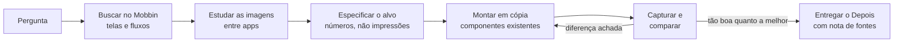

# mobbin-design-research

Transforme pesquisa no Mobbin em telas melhores: uma skill do Claude Code que estuda como apps reais resolvem um problema e depois refaz o seu design com base nessa evidência.

[](LICENSE)


[English](README.md) | Português (Brasil)

## O que faz

A maioria das buscas por referência termina num moodboard que ninguém usa. Esta skill torna a pesquisa responsável:

- Cada busca responde a uma pergunta nomeada, e cada tela citada leva o `mobbin_url` durável.
- Ela lê as regras do seu projeto primeiro. A pesquisa informa o design; nunca passa por cima do seu design system.
- Traz dois roteiros: **desenhar um fluxo do zero** e **melhorar uma tela existente** (sempre em cópia, com uma única versão "Depois" e uma nota que lista a fonte de cada mudança).
- Os dois roteiros terminam num **loop de captura e comparação** na sua ferramenta de design, repetido até a sua tela ficar pelo menos tão boa quanto a melhor referência.
- Guarda o que aprendeu (imagens baixadas, `REFERENCES.md`, `PATTERNS.md`) para a pesquisa sobreviver ao chat.

## Requisitos

- [Claude Code](https://claude.com/claude-code)
- Uma conta no Mobbin e o servidor MCP oficial do Mobbin, que fornece `search_screens`, `search_flows` e `search_sections` (e, opcionalmente, `list_collections`, `get_collection_contents`, `save_content`).
- Uma ferramenta de design da qual o agente consiga capturar telas. O Figma é o padrão; o loop funciona com qualquer ferramenta que permita "capturar e comparar".

## Instalação

```bash
git clone https://github.com/joaoezau/mobbin-design-research.git
cd mobbin-design-research

# Nível do usuário (todos os projetos)
mkdir -p ~/.claude/skills
cp -r skills/mobbin-design-research ~/.claude/skills/

# ou nível do projeto (só este projeto)
mkdir -p .claude/skills
cp -r skills/mobbin-design-research .claude/skills/
```

Reinicie o Claude Code (ou abra uma nova sessão) para ele carregar a skill.

### Conectar o MCP do Mobbin

Adicione o servidor MCP do Mobbin ao Claude Code seguindo a documentação do próprio Mobbin e entre com a sua conta. Confira com `/mcp` se as ferramentas do Mobbin aparecem na lista.

## Configuração

Copie o modelo para o seu projeto e preencha:

```bash
cp skills/mobbin-design-research/references/project-config.template.md ./project-config.md
```

Ele diz à skill onde fica o arquivo de regras (por exemplo `AGENTS.md` ou `CLAUDE.md`), a plataforma (`ios`, `android` ou `web`), a ferramenta de design e os nomes do design system, as pastas de referências curadas, os apps prioritários, as particularidades de nomes de apps e os limites de uso da sua ferramenta de design. Se o arquivo não existir, a skill se oferece para criá-lo e usa padrões razoáveis.

## Uso

Exemplos de pedidos:

- "Desenhe o onboarding do meu app de hábitos. Pesquise no Mobbin primeiro."
- "Melhore esta tela de ajustes. Veja como os melhores apps tratam interruptores agrupados."
- "Como outros apps mostram um contador de sequência? Traga 5 referências e extraia os números."
- "Aqui está um print de que gostei; ache onde mais esse padrão aparece e diga se devemos copiar."
- "Revise o fluxo do paywall contra os melhores fluxos de assinatura do Mobbin."

## Como funciona



As decisões seguem uma prioridade fixa: sua decisão explícita, seu arquivo de regras, sua curadoria, referências do Mobbin e, só então, o julgamento do agente (que vai na nota como sugestão, não no design).

## Estrutura do repositório

```
mobbin-design-research/
  README.md
  README.pt-BR.md
  LICENSE
  skills/mobbin-design-research/
    SKILL.md                              # ponto de entrada e regras de base
    references/
      flow-from-scratch.md                # roteiro: desenhar um fluxo ou área
      improve-a-screen.md                 # roteiro: melhorar uma tela, com o loop
      methods.md                          # como estudar fluxos e componentes
      project-config.template.md          # preencha por projeto
    examples/
      REFERENCES.example.md               # exemplo de references/mobbin/<area>/REFERENCES.md
      PATTERNS.example.md                 # exemplo de PATTERNS.md entre apps
```

## Créditos

Adaptada da skill `appllama-usage` do repositório [Appllama/appllama-skills](https://github.com/Appllama/appllama-skills) (MIT), da Antmind Ventures Private Limited ([appllama.io](https://appllama.io)). Esta versão a generaliza, adiciona uma configuração de projeto e reescreve os roteiros em torno do Mobbin.

## Licença

[MIT](LICENSE). Copyright (c) 2026 João Ezaú, e o copyright original da Antmind Ventures Private Limited.
